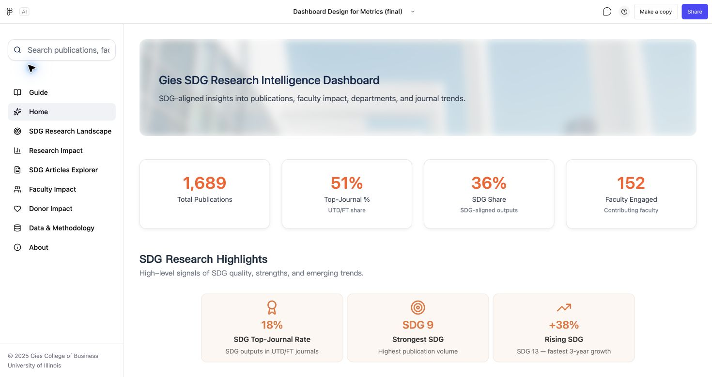
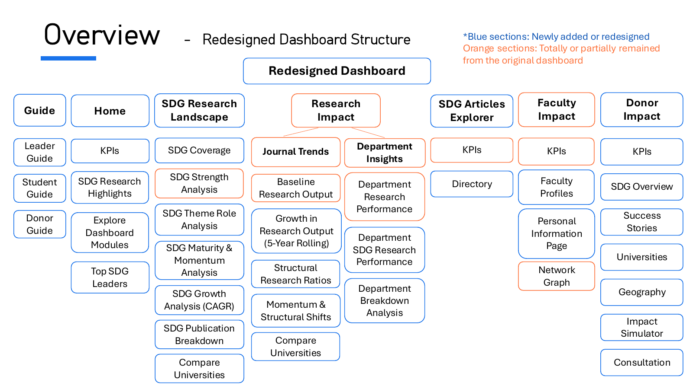
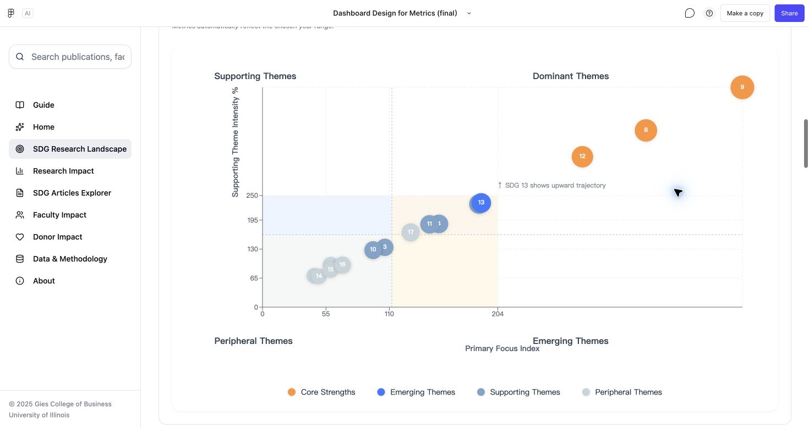
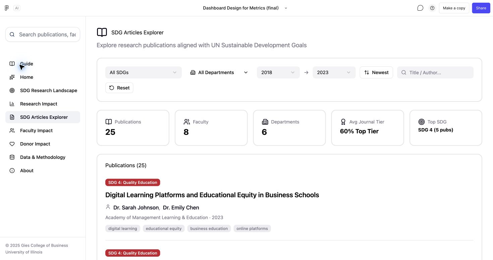
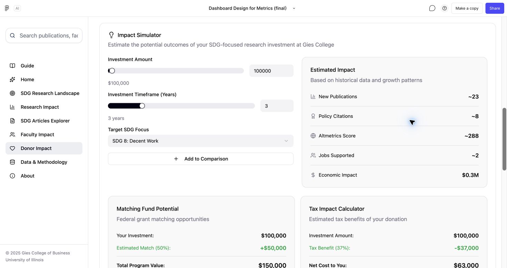

# Gies Sustainability Dashboard

A Pillar 3 entry for the **2025 Sustainability Expertise Case Competition**, sponsored by the **Center for Professional Responsibility in Business and Society (CPRBS)**. Our four-person team proposed a user-experience and visualization redesign of the existing Gies Sustainability Dashboard and demonstrated it through an interactive Figma Make prototype.

> **All dashboard data is simulated.** Every metric, publication record, faculty profile, institutional comparison, funding figure, success story, and simulator output is illustrative. The project demonstrates UX and interaction design; it reports no empirical findings or measured institutional outcomes.

[Explore the interactive prototype](https://www.figma.com/make/eoPnS9HrlcHqPfPAOvxH1E/Dashboard-Design-for-Metrics--final%EF%BC%89?code-node-id=1-5&p=f&t=R2nXAasMngESzVNB-0&fullscreen=1) · [Design case study](docs/case-study.md) · [Competition context](docs/competition-alignment.md) · [My contribution](docs/my-contribution.md) · [Team report](reports/Group5_report.pdf) · [Presentation](reports/Group5_ppt.pdf)



*Prototype homepage. All displayed values are simulated.*

## My role

**Ringing Song — Project Lead & Lead UX/Prototype Designer**

- Led the project's overall concept development and coordinated the four-person team.
- Conceived most of the journeys for leaders, students, and donors, connecting their goals to dashboard actions and relevant information.
- Built and iterated on most of the interactive website prototype using Figma Make and AI-assisted prototyping.
- Authored the Overview and Blueprint sections of both the team report and presentation.

The dashboard, report, and presentation are shared team deliverables. Team members: **Linyao Gao, Ringing Song, You (Mia) Wu, and Samyak Pokharna**.

## The design challenge

The selected track, **Pillar 3: The User Experience (Dashboard & Visualization Design)**, focuses on the landing page, advanced visualizations, and persona-specific navigation, search, filters, and drill-downs.

The team's evaluation identified a gap between the information presented in the original dashboard and the tasks different users wanted to complete. High-level research counts offered limited guidance for strategic comparison, publication discovery, faculty exploration, and donor scenarios.

The redesign asks: **How can a sustainability dashboard help different audiences move from an overview to information relevant to their next decision?**

## Three audiences, three journeys

| Audience | Goal | Proposed journey |
| --- | --- | --- |
| University leaders | Understand research strengths and explore resource priorities | Overview → peer benchmarking → faculty and department performance → illustrative impact stories → scenario simulation → prioritization |
| Prospective students | Find a faculty mentor in sustainable finance | Overview → finance-related article search and filters → faculty discovery → individual profile exploration |
| Donors | Explore support for renewable-energy research | SDG 7 / clean-energy exploration → impact simulation → illustrative success stories → geographic and university comparison |

The student and donor scenarios apply the brief's two specified tasks to the team's journey design. University leadership is an additional audience covered by the project. These are designed journeys; no interview study, usability-test results, or measured conversion improvements are claimed.

## Seven core modules

| Module | Design purpose |
| --- | --- |
| Guide | Provide entry points for the three persona journeys |
| Home | Summarize the research landscape with a clear KPI hierarchy and onward navigation |
| SDG Research Landscape | Explore coverage, distribution, theme roles, maturity, momentum, and growth |
| Research Impact | Examine journal trends, publication structure, departments, and peer comparisons |
| SDG Articles Explorer | Search and filter illustrative publication records |
| Faculty Impact | Explore illustrative faculty profiles, interests, and research connections |
| Donor Impact | Explore illustrative cases, universities, geography, and funding scenarios |

The prototype also includes supporting **Data & Methodology** and **About** pages.



*Information architecture from the team's original presentation: blue indicates new or redesigned sections; orange indicates retained or partially retained sections.*

## Selected design decisions

- **Put orientation first.** Separate a concise homepage from deeper analytical views, with a Guide that maps user goals to relevant sections.
- **Give charts a task.** Organize SDG exploration from coverage and distribution through strategic positioning, momentum, and detailed breakdowns.
- **Connect overview and detail.** Provide publication search and faculty profiles so students can move beyond aggregate charts.
- **Make scenarios interactive.** Let donors adjust hypothetical inputs and inspect illustrative outputs. All figures and model assumptions are simulated.

Read the [case study](docs/case-study.md) for the reasoning, journey details, and limits of the prototype.

## Interface gallery

### SDG research landscape



*The original dashboard's theme-positioning view compares primary focus and supporting-theme intensity, with bubble size representing the tertiary role. All data is simulated. See the [visualization gallery](docs/case-study.md#visualization-gallery) for the existing network graph, state heatmap, and state-by-SDG matrix.*

### Article discovery



*Publication titles, authors, journal associations, and counts are simulated demo content.*

### Donor scenario exploration



*All inputs, outputs, matching-fund figures, and tax examples are simulated. Existing interface wording about historical data is part of the original prototype copy and does not establish a real data source or validated forecasting model.*

## Project materials

```text
gies-sustainability-dashboard/
├── README.md
├── docs/
│   ├── case-study.md
│   ├── competition-alignment.md
│   └── my-contribution.md
├── images/
│   ├── dashboard-home.png
│   ├── sdg-research-landscape.png
│   ├── sdg-theme-positioning.png
│   ├── sdg-articles-explorer.png
│   ├── donor-impact-simulator.png
│   ├── faculty-network.png
│   ├── state-research-heatmap.png
│   ├── state-sdg-matrix.png
│   ├── information-architecture.png
│   ├── persona-module-blueprint.png
│   └── README.md
└── reports/
    ├── Group5_report.pdf
    ├── Group5_ppt.pdf
    └── README.md
```

The interactive implementation is hosted in the linked Figma Make project. This repository contains the portfolio case study, screenshots, and original team documents; it does not include a standalone application source export or a local build workflow.

## Scope and interpretation

- All dashboard data is simulated, including content that resembles live updates, real faculty or publications, historical evidence, or actual success stories.
- Institutional names provide the design context; displayed performance and outcomes are illustrative.
- The donor simulator is an interaction demonstration with hypothetical assumptions.
- The deliverable is a functional design prototype. Production deployment, backend integration, and validated analytical models are outside the demonstrated scope.
- Improved clarity and easier discovery are design objectives. No measured usability improvement, fundraising result, or adoption outcome is reported.
- External referral-page designs and a traffic-acquisition proposal were not included in the original submission; see the [competition context](docs/competition-alignment.md).

The original report and slides are preserved as submitted. Their data-access assumptions and impact language should be read alongside the [data clarification](reports/README.md).
