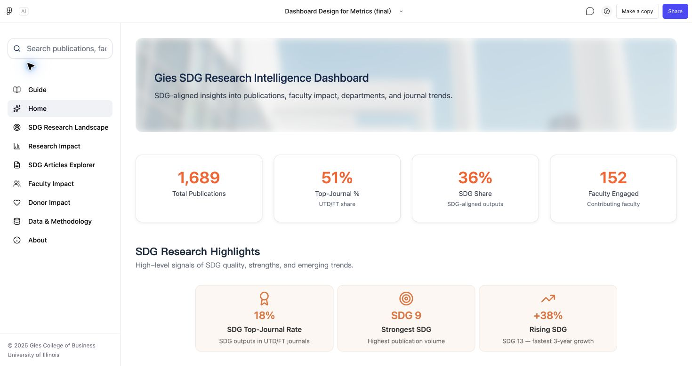
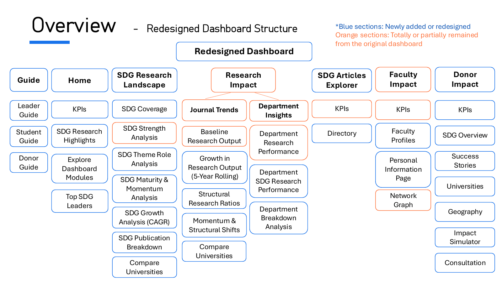
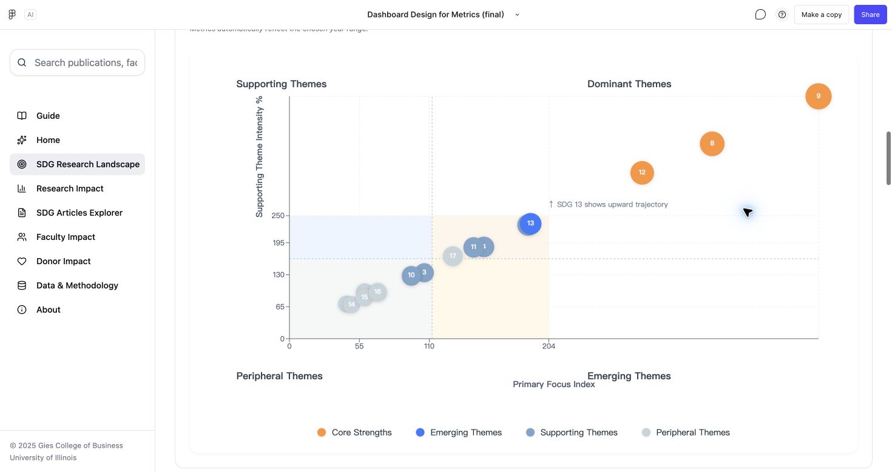
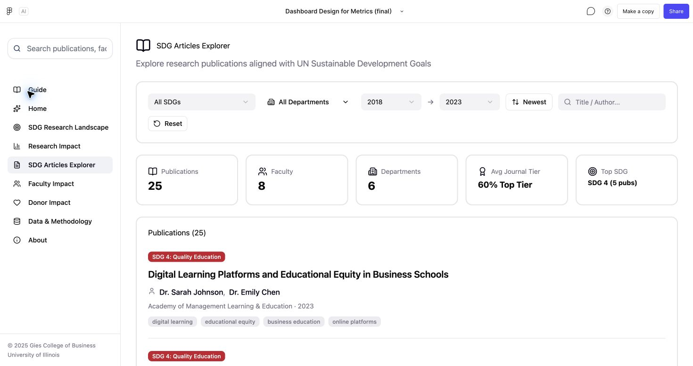
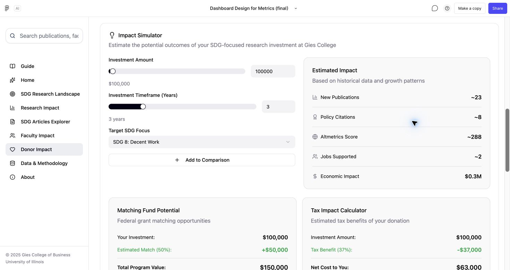

# Gies 可持续发展研究看板

[English](README.md) | 简体中文

本项目围绕 Gies Sustainability Dashboard 开展用户体验重设计，参加由 CPRBS 支持的 **2025 Sustainability Expertise Case Competition，Pillar 3 用户体验与可视化设计方向**。

**Figma Make · 用户体验设计 · 用户旅程 · 信息架构 · 数据可视化**

## 项目概览

- **项目任务**：围绕大学管理者、准学生和捐赠者的具体任务，组织与联合国可持续发展目标（SDG）相关的研究信息。
- **用户体验设计**：设计 **3 类用户旅程**和 **7 个核心模块的信息架构**，串联研究概览、论文检索、教师资料与捐赠情景。
- **可视化与交互**：结合**象限图、教师关系网络和州级热力图**，实现关键词搜索、筛选、节点详情查看与可调节的资助情景。
- **项目交付**：搭建 **Figma Make 交互原型**，通过团队报告和 PPT 说明看板结构、用户旅程与设计决策。

看板中的全部数据均为**模拟数据**，用于展示交互设计中的指标、记录、比较、案例与情景输出。

## 我的贡献

- **用户体验策略与用户旅程**：确定整体改版方向，提出大部分看板设计构想，并主导 **管理者、学生和捐赠者** 三类用户的旅程设计。[用户旅程蓝图](images/persona-module-blueprint.png)
- **交互原型**：使用 Figma Make 完成 **交互看板大部分页面与交互的搭建和迭代**，串联 SDG 分析、论文检索、教师资料与捐赠情景。[原型](https://www.figma.com/make/eoPnS9HrlcHqPfPAOvxH1E/Dashboard-Design-for-Metrics--final%EF%BC%89?code-node-id=1-5&fullscreen=1)
- **项目统筹与团队领导**：代表团队与指导教师沟通；统筹项目进度、分配任务、组织会议，并通过建议与反馈指导队员完成各自内容。
- **报告与汇报**：负责报告和 PPT 中 **Overview（概览）与 Blueprint（蓝图）** 部分的撰写和制作，并在最终团队汇报中讲解这两部分。[报告](reports/Group5_report.pdf) · [PPT](reports/Group5_ppt.pdf)

*原型首页，全部展示数据均为模拟数据。*

## 项目内容

| 内容 | 材料入口 |
|---|---|
| 交互看板 | [Figma Make 原型](https://www.figma.com/make/eoPnS9HrlcHqPfPAOvxH1E/Dashboard-Design-for-Metrics--final%EF%BC%89?code-node-id=1-5&p=f&t=R2nXAasMngESzVNB-0&fullscreen=1) |
| 设计过程与用户旅程 | [完整案例](docs/case-study.md) |
| 高级可视化 | [图表展示](docs/case-study.md#visualization-gallery) |
| 团队交付物 | [报告](reports/Group5_report.pdf) · [PPT](reports/Group5_ppt.pdf) |

## 设计问题

团队围绕简洁的首页、高级可视化，以及通过搜索、筛选和详情查看完成任务的导航流程开展重设计。

团队评估了原看板的信息呈现与各类用户任务之间的关系，梳理战略比较、论文发现、教师探索与捐赠情景所需的信息及入口。

核心设计问题是：**如何帮助不同受众从研究概览出发，找到与其下一步决策相关的信息？**

## 三类用户与旅程

| 用户 | 目标 | 设计的旅程 |
|---|---|---|
| 大学管理者 | 了解研究优势，探索资源配置方向 | 研究概览 → 院校比较 → 教师与院系表现 → 模拟影响案例 → 资助情景 → 优先方向梳理 |
| 准学生 | 寻找可持续金融领域的导师 | 概览 → 金融相关论文搜索与筛选 → 教师发现 → 个人资料查看 |
| 捐赠者 | 探索对可再生能源研究的支持 | SDG 7／清洁能源探索 → 资助情景模拟 → 模拟案例 → 地域与院校比较 |

团队为三类受众设计了用户旅程，将目标与相应页面、搜索控件、筛选及详情视图关联起来。学生与捐赠者的示例分别围绕可持续金融导师选择和可再生能源研究资助展开。

## 七个核心模块

| 模块 | 设计用途 |
|---|---|
| Guide 导览 | 提供三类用户旅程的入口 |
| Home 首页 | 通过有层次的 KPI 和导航入口呈现研究概览 |
| SDG Research Landscape 研究全景 | 探索覆盖度、分布、主题角色、成熟度、发展势头与增长 |
| Research Impact 研究影响 | 查看期刊趋势、发表结构、院系表现与院校比较 |
| SDG Articles Explorer 论文检索 | 搜索与筛选模拟论文记录 |
| Faculty Impact 教师影响 | 探索模拟教师资料、研究兴趣与关系网络 |
| Donor Impact 捐赠影响 | 探索模拟案例、院校、地域与资助情景 |

原型还包含 **Data & Methodology（数据与方法）**和 **About（关于）**支持页面。

*原团队 PPT 中的信息架构图：蓝色表示新增或重设计内容，橙色表示保留或部分保留的内容。*

## 主要设计决策

- **先建立整体认识：**通过简洁的首页提供概览，再由 Guide 将用户目标与相关模块连接起来。
- **让图表服务具体任务：**按覆盖度、分布、战略定位、发展势头和详细拆解组织 SDG 探索。
- **连接概览与详情：**通过论文检索和教师资料，支持从整体研究主题进入具体记录。
- **让情景可交互：**让捐赠者调节模拟投入与时间，查看相应的示例输出。所有数值与模型假设均用于模拟展示。

设计思路、用户旅程和图表展示见[完整案例](docs/case-study.md)。

## 界面展示

### SDG 研究全景

*主题定位视图比较主要主题关注度与支持主题强度，并用气泡大小表达第三主题角色。所有数据均为模拟数据。网络图、州级热力图和州 × SDG 矩阵见[图表展示](docs/case-study.md#visualization-gallery)。*

### 论文发现

*论文题目、作者、期刊关联和数量均为模拟展示内容。*

### 捐赠情景探索

*模拟器展示可调节的资金、时间输入与示例输出。全部数值、配套资金和税务示例均为模拟内容。*

## 原型数据

看板使用模拟数据展示所设计的交互、可视化与资助情景。院校名称提供项目背景，展示的指标与结果用于示例说明。

[团队报告与 PPT](reports/README.md)记录了看板结构、用户旅程与设计决策。

团队成员：**Linyao Gao、Ringing Song、You（Mia）Wu 和 Samyak Pokharna**。
