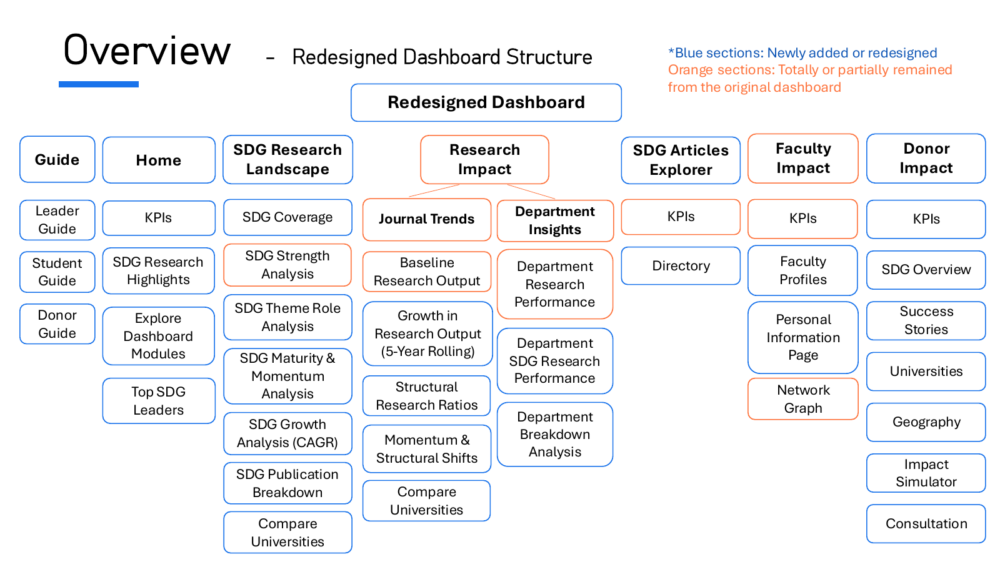
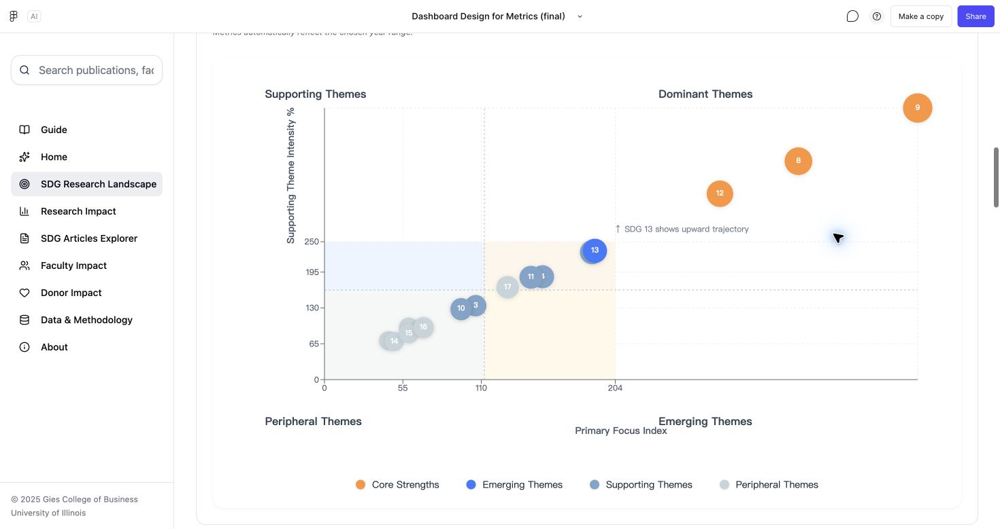
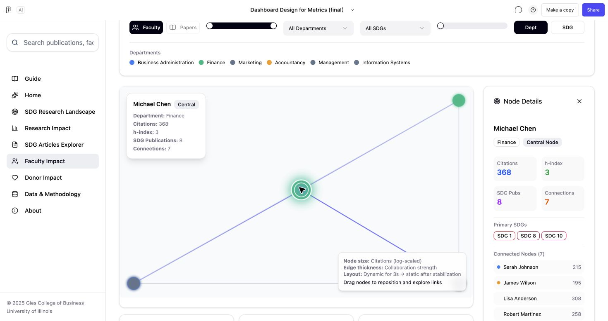
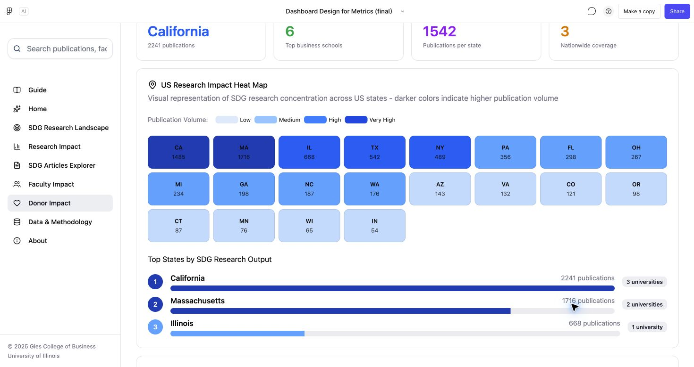
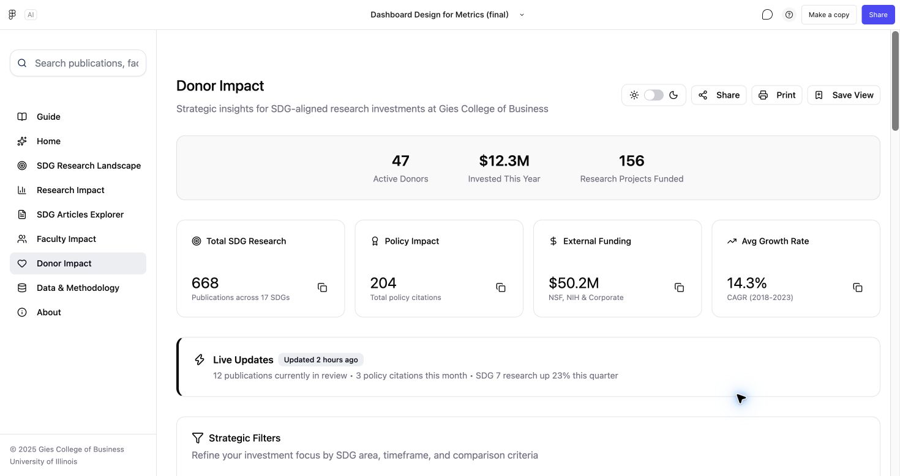

# Design case study

[Back to project overview](../README.md) · [Competition context](competition-alignment.md) · [Personal contribution](my-contribution.md) · [Original team report](../reports/Group5_report.pdf)

> All dashboard data is simulated. The metrics, records, comparisons, cases, and scenario outputs support a design demonstration.

## Context and problem framing

This project was developed for **Pillar 3: The User Experience (Dashboard & Visualization Design)** of the **2025 Sustainability Expertise Case Competition**, sponsored by CPRBS. It revisits the existing Gies Sustainability Dashboard through the needs of three intended audiences. The team's evaluation described a dashboard with useful categories of research information but gaps in how users could navigate, compare, and connect that information to a task.

The redesign focuses on three questions:

1. How can a prospective student find a faculty mentor in sustainable finance?
2. How can a donor explore support for renewable-energy research?
3. How can leaders move from a broad research overview to areas they may want to investigate further?

The first two tasks are specified in the competition brief. The leadership journey extends the design to another audience identified in the wider competition context. The [requirement mapping](competition-alignment.md) records both the work presented and the external-referral-page requirement that the original submission did not cover.

The project assumes that the kinds of data needed for these workflows could be available in a future implementation. The prototype itself uses simulated data throughout.

## Design process

The team report describes a persona-based evaluation and redesign:

1. Define the audiences and their goals.
2. Map the steps each audience might take.
3. Identify information and navigation gaps in those steps.
4. Propose changes to modules, visualizations, and navigation.
5. Connect the revised sections into new user journeys.
6. Demonstrate the proposal in an interactive Figma Make prototype and explain it in a report and presentation.

This is a design-led evaluation. The supplied materials do not establish a user-interview sample, controlled usability study, or measured performance gain.

## Information architecture

Information architecture covers the grouping, hierarchy, and navigation of the dashboard's content. The team's seven core modules give users an overview, analytical views, detailed records, and persona-specific entry points.

**Guide** provides task-oriented starting points. **Home** provides a concise overview. **SDG Research Landscape** organizes theme-level analysis. **Research Impact** covers publication structure, trends, departments, and comparison. **SDG Articles Explorer** provides access to illustrative records. **Faculty Impact** supports researcher discovery. **Donor Impact** groups hypothetical giving scenarios, geographic comparisons, institutional comparisons, and illustrative cases.

Supporting Data & Methodology and About pages provide additional context in the prototype.

## Landing page hierarchy

The homepage uses four primary summary cards: Total Publications, Top-Journal Percentage, SDG Share, and Faculty Engaged. Together they introduce scale, publication quality, sustainability focus, and the size of the research community. This provides a four-item response to the brief's request for three to five critical pieces of first-glance information.

The SDG highlights form a secondary layer for thematic quality, strength, and growth. Module links and the Guide provide onward navigation. All card values are simulated; the design rationale concerns information hierarchy.

## Match modules to audience needs

The Blueprint maps dashboard sections to each persona so that the proposed navigation follows a goal rather than requiring everyone to explore every chart.

The original slide labels some sections as unnecessary for particular audiences. In this case study, these indicate the team's proposed primary paths; they do not establish that other users could never benefit from those sections.

## Leader journey

| Step | User question | Proposed response |
| --- | --- | --- |
| 1. Orientation | What is the overall research profile? | Home summaries and SDG landscape views |
| 2. Benchmarking | How might this institution compare with peers? | University comparison views using simulated records |
| 3. Contributor exploration | Which departments and faculty align with an area of interest? | Department insights and faculty profiles |
| 4. Narrative exploration | How could research impact be communicated? | Illustrative success stories |
| 5. Scenario exploration | What might a hypothetical funding scenario look like? | Adjustable impact simulator |
| 6. Review | Which areas deserve further investigation? | Cross-check the preceding views |

The redesigned sequence is intended to support investigation and prioritization. The simulated data does not justify actual institutional resource allocation.

## Student journey

**Task: a prospective student seeks a faculty mentor in sustainable finance.** The steps below explain the original general student journey using the brief's specific topic. They describe the intended use of existing search, filters, publication cards, and faculty profiles; they do not claim a separate topic-specific usability test.

| Step | User question | Proposed response |
| --- | --- | --- |
| 1. Orientation | Where can I explore sustainability-related research? | Home and SDG Research Landscape, with Guide as a starting point |
| 2. Publication discovery | Which illustrative papers relate to sustainable finance? | SDG Articles Explorer: finance-related keyword search, department and year controls, and relevant SDG filters |
| 3. Faculty discovery | Which faculty are associated with those topics? | Review publication authors, then explore Faculty Impact and its thematic profiles |
| 4. Detail exploration | Which faculty interests might fit my intended study? | Open individual profiles and review summaries and illustrative publications to form a mentor shortlist |

The design connects aggregate information to individual records. All publications, faculty details, and associations shown in the demo are simulated.

## Donor journey

**Task: a donor is interested in funding renewable-energy research.** This scenario applies the original donor journey to clean energy, using SDG 7 as a relevant starting point. Its output is an illustrative exploration of funding choices.

| Step | User question | Proposed response |
| --- | --- | --- |
| 1. Theme exploration | How can I explore research relevant to renewable energy? | Home, SDG Research Landscape, and the donor overview; select the relevant SDG 7 / clean-energy focus |
| 2. Scenario exploration | How could different funding amounts and durations be explored? | Impact Simulator: choose a target SDG, change hypothetical amount and timeframe, and inspect illustrative outputs |
| 3. Narrative exploration | How could research outcomes be communicated? | Review illustrative Success Stories within the donor module |
| 4. Geographic comparison | How could I explore regional research activity? | Geography views and their state-level comparisons |
| 5. Institutional comparison | How could I compare institutional research profiles? | Universities views and their comparative charts |

The simulator demonstrates the relationship between editable inputs and displayed outputs. Publication projections, economic impact, matching funds, tax examples, and comparisons are all simulated. The prototype does not establish a predictive model or verified case evidence.

## Visualization rationale

The original dashboard prototype already includes advanced visualizations. The portfolio explanation connects these existing views to the tasks they support:

- Coverage summaries introduce research breadth across SDGs.
- Distribution charts make relative volumes visible.
- Quadrant views propose ways to explore theme roles, maturity, and momentum.
- Growth views, including CAGR, give users a time-oriented lens.
- Department and university comparisons add organizational context.
- Article and faculty views connect summary patterns to illustrative records.

Quadrant views put two dimensions in the same frame so users can inspect theme position and momentum together. Heatmaps expose concentrations across a matrix. Network views emphasize relationships between researchers, and state-level views organize comparisons by region. These choices support different comparisons from a single ranked list. Their effectiveness remains a design rationale rather than a measured usability finding.

These are proposed visual encodings and metric concepts. Because all data is simulated, the shapes and rankings shown do not describe actual research performance. Cross-view numerical consistency and scoring validity were not established during repository preparation.

## Visualization gallery

The screenshots below were captured from views already present in the original dashboard. They document existing visualization and interaction work; the prototype was not redesigned to create these portfolio images. All displayed records, relationships, and figures are simulated.

### SDG theme positioning

The view compares primary and supporting theme measures, while bubble size conveys the tertiary theme role. It lets users inspect several aspects of SDG positioning in one view. The dashboard's year-range controls provide temporal context.

### Faculty network and node details

The network includes department, SDG, year-range, and link-strength controls, as well as node coloring. Selecting a node opens researcher details and connected-node information. This selected-node interaction was checked when capturing the screenshot. Node size and edge width encode the prototype's simulated citation and relationship measures.

### State-level research comparison

The Geography section represents states as color-coded tiles and provides a ranked comparison below. This is a state-level comparison view; the tiles do not reproduce geographic boundaries or distances.

### State by SDG matrix

Rows represent states and columns represent SDG themes. The matrix places regional and thematic comparisons together, using cell labels and color to communicate the illustrative values. It offers a different view from the single overall state ranking.

## Deliverables and what they show

The project produced an interactive Figma Make prototype, a 46-page report, and a 49-page presentation. Together they demonstrate a proposed dashboard structure, persona journeys, visualization concepts, and detailed interface behaviors.

The portfolio outcome is the design and prototype. The supplied materials do not establish production adoption, real data integration, validated impact prediction, measured task-time reductions, or funding outcomes.

## External referral pages

The brief also asks teams to consider pages that could link visitors into the dashboard and how to attract traffic. This concerns the design and placement of entry points on other sites, such as admissions, research, or giving pages, together with the destination and initial task inside the dashboard.

The team did not include an external referral-page or traffic-acquisition proposal in its original submission. It is recorded here as an uncovered part of the brief. The dashboard's internal Guide and module navigation address movement within the product.

## Portfolio documentation

The original report, presentation, and Figma Make prototype remain the historical project artifacts. Competition context, the topic-specific explanations of the general journeys, and the requirement mapping were added when preparing this portfolio documentation after reviewing the brief. They do not revise the original submitted PDFs or add external-page designs to the original work.

## Next validation steps

Further development could evaluate whether representative users can complete each journey, whether the terminology and charts are understandable, and whether related views remain consistent under filtering. A production version would also need explicit metric definitions and real, documented data sources.

These are proposed next steps; they were not completed as part of this repository preparation.
