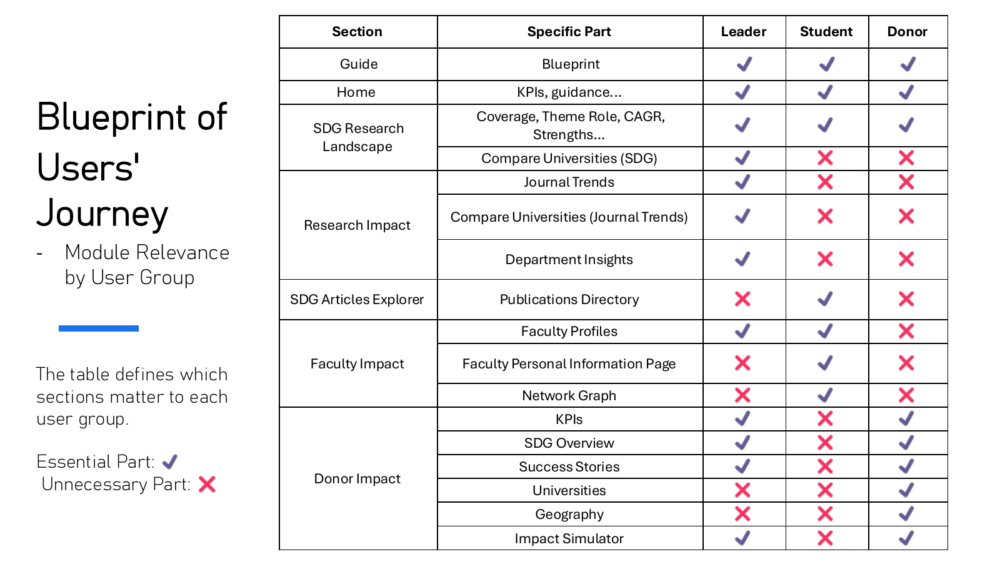

# Design case study

[Back to project overview](../README.md) · [Personal contribution](my-contribution.md) · [Original team report](../reports/Group5_report.pdf)

> All dashboard data is simulated. The metrics, records, comparisons, cases, and scenario outputs support a design demonstration.

## Context and problem framing

The project revisits the Gies Sustainability Dashboard through the needs of three intended audiences. The team's evaluation described a dashboard with useful categories of research information but gaps in how users could navigate, compare, and connect that information to a task.

The redesign focuses on three questions:

1. How can leaders move from a broad research overview to areas they may want to investigate further?
2. How can students find relevant publications and connect them to faculty interests?
3. How can donors explore sustainability themes and understand hypothetical funding scenarios?

The project assumes that the kinds of data needed for these workflows could be available in a future implementation. The prototype itself uses simulated data throughout.

## Design process

The team report describes a persona-based evaluation and redesign:

1. Define the audiences and their goals.
2. Map the steps each audience might take.
3. Identify information and navigation gaps in those steps.
4. Propose changes to modules, visualizations, and navigation.
5. Connect the revised sections into new user journeys.
6. Demonstrate the proposal in an interactive Figma Make prototype and explain it in a report and presentation.

This is a design-led evaluation. The supplied materials do not establish a user-interview sample, controlled usability study, or measured performance gain.

## Information architecture

Information architecture covers the grouping, hierarchy, and navigation of the dashboard's content. The team's seven core modules give users an overview, analytical views, detailed records, and persona-specific entry points.

**Guide** provides task-oriented starting points. **Home** provides a concise overview. **SDG Research Landscape** organizes theme-level analysis. **Research Impact** covers publication structure, trends, departments, and comparison. **SDG Articles Explorer** provides access to illustrative records. **Faculty Impact** supports researcher discovery. **Donor Impact** groups hypothetical giving scenarios, geographic comparisons, institutional comparisons, and illustrative cases.

Supporting Data & Methodology and About pages provide additional context in the prototype.

## Match modules to audience needs

The Blueprint maps dashboard sections to each persona so that the proposed navigation follows a goal rather than requiring everyone to explore every chart.

The original slide labels some sections as unnecessary for particular audiences. In this case study, these indicate the team's proposed primary paths; they do not establish that other users could never benefit from those sections.

## Leader journey

| Step | User question | Proposed response |
| --- | --- | --- |
| 1. Orientation | What is the overall research profile? | Home summaries and SDG landscape views |
| 2. Benchmarking | How might this institution compare with peers? | University comparison views using simulated records |
| 3. Contributor exploration | Which departments and faculty align with an area of interest? | Department insights and faculty profiles |
| 4. Narrative exploration | How could research impact be communicated? | Illustrative success stories |
| 5. Scenario exploration | What might a hypothetical funding scenario look like? | Adjustable impact simulator |
| 6. Review | Which areas deserve further investigation? | Cross-check the preceding views |

The redesigned sequence is intended to support investigation and prioritization. The simulated data does not justify actual institutional resource allocation.

## Student journey

| Step | User question | Proposed response |
| --- | --- | --- |
| 1. Orientation | Which sustainability topics can I explore? | Home and SDG Research Landscape |
| 2. Publication discovery | Which records match my topic? | Article filters and keyword search |
| 3. Faculty discovery | Which researchers are associated with those interests? | Faculty directory and thematic profiles |
| 4. Detail exploration | What else can I learn about a researcher? | Profile summaries and illustrative publication lists |

The design connects aggregate information to individual records. All publications, faculty details, and associations shown in the demo are simulated.

## Donor journey

| Step | User question | Proposed response |
| --- | --- | --- |
| 1. Theme exploration | Which SDG themes match my interests? | Home, SDG landscape, and donor overview |
| 2. Scenario exploration | How might different hypothetical inputs be presented? | Impact Simulator |
| 3. Narrative exploration | How could outcomes be communicated? | Illustrative Success Stories |
| 4. Geographic comparison | How could activity be compared across regions? | Geography views |
| 5. Institutional comparison | How could I inspect peer institutions? | Universities views |

The simulator demonstrates the relationship between editable inputs and displayed outputs. Publication projections, economic impact, matching funds, tax examples, and comparisons are all simulated. The prototype does not establish a predictive model or verified case evidence.

## Visualization rationale

The design extends basic publication counts with several ways of organizing information:

- Coverage summaries introduce research breadth across SDGs.
- Distribution charts make relative volumes visible.
- Quadrant views propose ways to explore theme roles, maturity, and momentum.
- Growth views, including CAGR, give users a time-oriented lens.
- Department and university comparisons add organizational context.
- Article and faculty views connect summary patterns to illustrative records.

These are proposed visual encodings and metric concepts. Because all data is simulated, the shapes and rankings shown do not describe actual research performance. Cross-view numerical consistency and scoring validity were not established during repository preparation.

## Deliverables and what they show

The project produced an interactive Figma Make prototype, a 46-page report, and a 49-page presentation. Together they demonstrate a proposed dashboard structure, persona journeys, visualization concepts, and detailed interface behaviors.

The portfolio outcome is the design and prototype. The supplied materials do not establish production adoption, real data integration, validated impact prediction, measured task-time reductions, or funding outcomes.

## Next validation steps

Further development could evaluate whether representative users can complete each journey, whether the terminology and charts are understandable, and whether related views remain consistent under filtering. A production version would also need explicit metric definitions and real, documented data sources.

These are proposed next steps; they were not completed as part of this repository preparation.
